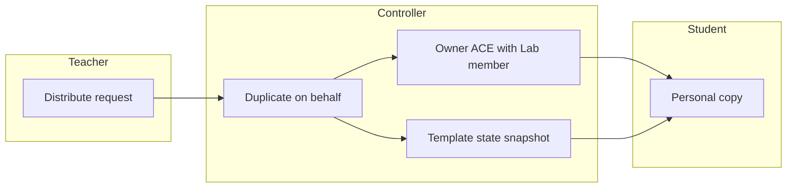
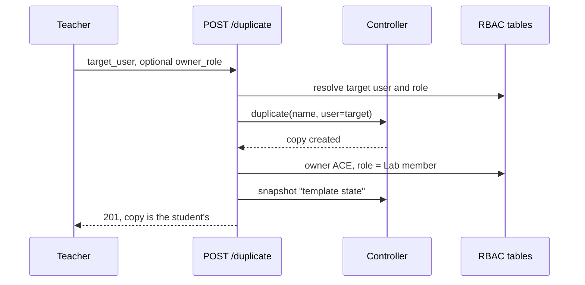

# Project Distribution

## Overview

A duplication can be made on behalf of other users: `POST /projects/{project_id}/duplicate` with `target_user` set creates a copy owned by that user; with `target_users` (a list) or `target_group` (a whole group), every listed user or group member receives their own copy in one call. This is how a lab built by a teacher reaches every student: each recipient gets a personal copy they can use but not edit, because the owner ACE written on the copy carries a reduced role — the built-in "Lab member" role by default — instead of the full role the recipient keeps on their own projects.

A group distribution is a fan-out, not a share: each member works on their own copy in isolation, and a restore resets only their copy. Sharing one project between several users is a different need, already covered by a resource pool or an explicit group ACE.

The copy also ships with a "template state" snapshot, so a recipient can reset the lab to its initial state on their own (`Snapshot.Restore`).

## Terms

| Term | Meaning |
|---|---|
| Distribution | A duplication with `target_user`, `target_users` or `target_group` set: the copy belongs to the recipient(s) |
| Group distribution | A fan-out: one copy per group member, each owned by that member |
| Owner ACE | The user-level ACE on `/projects/<project_id>` created with every new project |
| Lab member | Built-in role carried by distributed copies by default: use the lab, do not touch the topology |
| Template state | Snapshot taken right after a distributed copy is created; the reset anchor for the recipient |

## Architecture

The freeze does not come from a new enforcement mechanism: it comes from the ACE evaluation rule. A user-level ACE covering a path decides the check alone, whatever role it carries (`gns3server/db/rbac_state.py`). The recipient's own projects are untouched: their owner ACE carries the full role that allowed the creation, and group-level grants keep applying everywhere else.

## Business Process

After the distribution, the recipient lists the copy like any of their projects (`Project.Audit`), opens it (`Project.Allocate`), works on the nodes (`Node.Console`, `Node.PowerMgmt`, `Link.Capture`), and resets it by restoring the "template state" snapshot (`Snapshot.Restore`). Topology edits — project updates, node or link changes, drawings, new nodes — are denied: the role does not carry those privileges, and the user-level owner ACE blocks any group-level grant that would.

## API Endpoints

| Method | Path | Description | Privilege |
|---|---|---|---|
| POST | `/v3/projects/{project_id}/duplicate` | Duplicate, or distribute with `target_user` / `target_users` / `target_group` | `Project.Audit`, plus `Project.Allocate` somewhere the copy can live |

Request fields added to `ProjectDuplicate`:

| Field | Type | Description |
|---|---|---|
| `target_user` | string, optional | Username receiving the copy. Missing user: 404 |
| `target_users` | list of strings, optional | Every listed user receives their own copy. Unknown name: 404 before any copy is made; an empty list: 422 |
| `target_group` | string, optional | User group name: every member receives their own copy. Missing group: 404, empty group: 409 |
| `owner_role` | string, optional | Role of the owner ACE on the copy. Default: `Lab member`. Missing role: 404 |

`target_user`, `target_users` and `target_group` cannot be combined (422). The response is the new `Project` for a plain duplication or a single-user distribution. A multi-recipient distribution returns one result per recipient instead: `{username, project, error}`, where `project` is the recipient's copy on success and `error` carries the message when their copy could not be created (the other recipients are unaffected).

## Notes

The "Lab member" role carries exactly these privileges: `Project.Allocate`, `Project.Audit`, `Snapshot.Audit`, `Snapshot.Restore`, `Node.Audit`, `Node.Console`, `Node.PowerMgmt`, `Link.Audit`, `Link.Capture`, `Drawing.Audit`. `Project.Allocate` is required to open a project at all (everything under an open project is gated by `open_required`); on the copy path it also lets the recipient delete their own copy. Creating other projects is ruled by the collection ACE on `/projects`, not by the copy.

A distributed copy is personal: it does not inherit the resource pools of the source project, and the distributing user has no access to it (an explicit share or a superadmin is needed to watch a recipient's work).

A group distribution reaches the members of the group at the time of the call. Members added later have no copy: the teacher distributes again for them. Copies of a multi-recipient distribution are named after the lab and the recipient (`lab1-alice`).

`owner_role` accepts any existing role, custom ones included. An ACE on `/projects/<project_id>` can only reach project-scoped paths, so even a generous role cannot unlock user, compute or server administration through a copy.

Snapshots of the source project ride along with the copy. If the source already has a "template state" snapshot, the copy keeps it instead of creating a second one.
