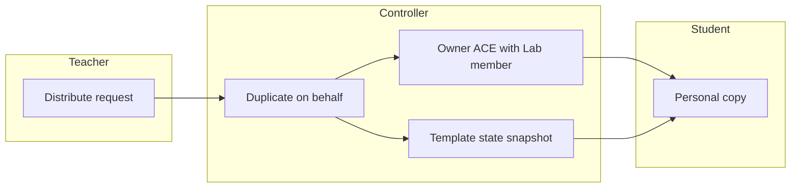
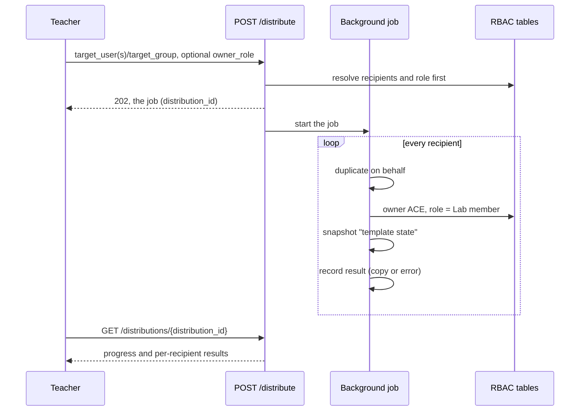

# Project Distribution

## Overview

`POST /projects/{project_id}/distribute` creates one copy of a project per recipient: a single user (`target_user`), every listed user (`target_users`) or every member of a user group (`target_group`). The copies are made by a background job — the request returns `202 Accepted` immediately with the job, and the client follows the progress by polling `GET /projects/{project_id}/distributions/{distribution_id}`. This is how a lab built by a teacher reaches every student: each recipient gets a personal copy they can use but not edit, because the owner ACE written on the copy carries a reduced role — the built-in "Lab member" role by default — instead of the full role the recipient keeps on their own projects. A plain duplication stays a separate operation (`POST /projects/{project_id}/duplicate`): the copy belongs to the caller.

A group distribution is a fan-out, not a share: each member works on their own copy in isolation, and a restore resets only their copy. Sharing one project between several users is a different need, covered by [project sharing](project-sharing.md) and resource pools.

The copy also ships with a "template state" snapshot, so a recipient can reset the lab to its initial state on their own (`Snapshot.Restore`).

## Terms

| Term | Meaning |
|---|---|
| Distribution | One copy per recipient via the distribute endpoint: each copy belongs to its recipient |
| Distribution job | The background task making the copies; it records one result per recipient and is polled by the client |
| Group distribution | A fan-out: one copy per group member, each owned by that member |
| Owner ACE | The user-level ACE on `/projects/<project_id>` created with every new project |
| Lab member | Built-in role carried by distributed copies by default: use the lab, do not touch the topology |
| Template state | Snapshot taken right after a distributed copy is created; the reset anchor for the recipient |

## Architecture

The freeze does not come from a new enforcement mechanism: it comes from the ACE evaluation rule. A user-level ACE covering a path decides the check alone, whatever role it carries (`gns3server/db/rbac_state.py`). The recipient's own projects are untouched: their owner ACE carries the full role that allowed the creation, and group-level grants keep applying everywhere else.

## Business Process

After the distribution, the recipient lists the copy like any of their projects (`Project.Audit`), opens it (`Project.Allocate`), works on the nodes (`Node.Console`, `Node.PowerMgmt`, `Link.Capture`), and resets it by restoring the "template state" snapshot (`Snapshot.Restore`). Topology edits — project updates, node or link changes, drawings, new nodes — are denied: the role does not carry those privileges, and the user-level owner ACE blocks any group-level grant that would.

## API Endpoints

| Method | Path | Description | Privilege |
|---|---|---|---|
| POST | `/v3/projects/{project_id}/distribute` | Start a distribution job: one copy per recipient, in the background. Returns `202` with the job | `Project.Audit`, plus `Project.Allocate` somewhere the copy can live |
| GET | `/v3/projects/{project_id}/distributions` | List the recent distribution jobs of the project (the caller's own; every one for a superadmin) | `Project.Audit` |
| GET | `/v3/projects/{project_id}/distributions/{distribution_id}` | Poll one job: status, progress and the per-recipient results so far | `Project.Audit` |
| POST | `/v3/projects/{project_id}/duplicate` | Duplicate: the copy belongs to the caller | `Project.Audit`, plus `Project.Allocate` somewhere the copy can live |

Request fields of `ProjectDistribute`:

| Field | Type | Description |
|---|---|---|
| `name` | string | Base name of the copies (required) |
| `reset_mac_addresses` | bool, optional | Reset MAC addresses on every copy |
| `target_user` | string, optional | Username receiving the copy, named `name`. Missing user: 404 |
| `target_users` | list of strings, optional | Every listed user receives their own copy, named `name-username`. Unknown name: 404 before the job starts; an empty list: 422 |
| `target_group` | string, optional | Every member of the group receives their own copy, named `name-username`. Missing group: 404, empty group: 409 |
| `owner_role` | string, optional | Role of the owner ACE on the copies. Default: `Lab member`. Missing role: 404 |

Exactly one of `target_user`, `target_users` or `target_group` must be set (combining them, or none: 422). Recipients and role are resolved before the job starts, so a bad request distributes nothing.

The `202` response (and every poll) is the job: `{distribution_id, project_id, name, created_by, status, total, completed, results, error}`. `status` is `running`, `completed` or `failed`; `completed` counts the recipients processed so far, successful or not. `results` grows as the job goes: one `{username, project, error}` per recipient, where `project` is the recipient's copy on success and `error` carries the message when their copy could not be created (a failing recipient never stops the job; the others are unaffected). `error` on the job itself is set only when the job as a whole failed.

## Notes

The "Lab member" role carries exactly these privileges: `Project.Allocate`, `Project.Audit`, `Snapshot.Audit`, `Snapshot.Restore`, `Node.Audit`, `Node.Console`, `Node.PowerMgmt`, `Link.Audit`, `Link.Capture`, `Drawing.Audit`. `Project.Allocate` is required to open a project at all (everything under an open project is gated by `open_required`); on the copy path it also lets the recipient delete their own copy. Creating other projects is ruled by the collection ACE on `/projects`, not by the copy.

A distributed copy is personal: it does not inherit the resource pools of the source project, and the distributing user has no access to it (an explicit share or a superadmin is needed to watch a recipient's work).

A group distribution reaches the members of the group at the time of the call. Members added later have no copy: the teacher distributes again for them. Copies of a multi-recipient distribution are named after the lab and the recipient (`lab1-alice`).

`owner_role` accepts any existing role, custom ones included. An ACE on `/projects/<project_id>` can only reach project-scoped paths, so even a generous role cannot unlock user, compute or server administration through a copy.

Snapshots of the source project ride along with the copy. If the source already has a "template state" snapshot, the copy keeps it instead of creating a second one.

Distribution jobs live in an in-process registry, like the rest of the controller state. A finished job stays queryable for one hour, then it is pruned. Restarting the server loses the job records — the copies already created are real projects and are unaffected — which is the documented trade-off until distribution records are persisted.
