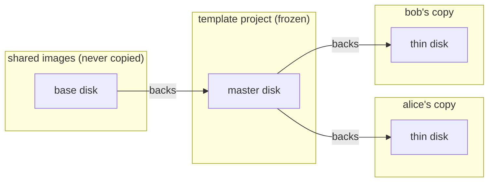
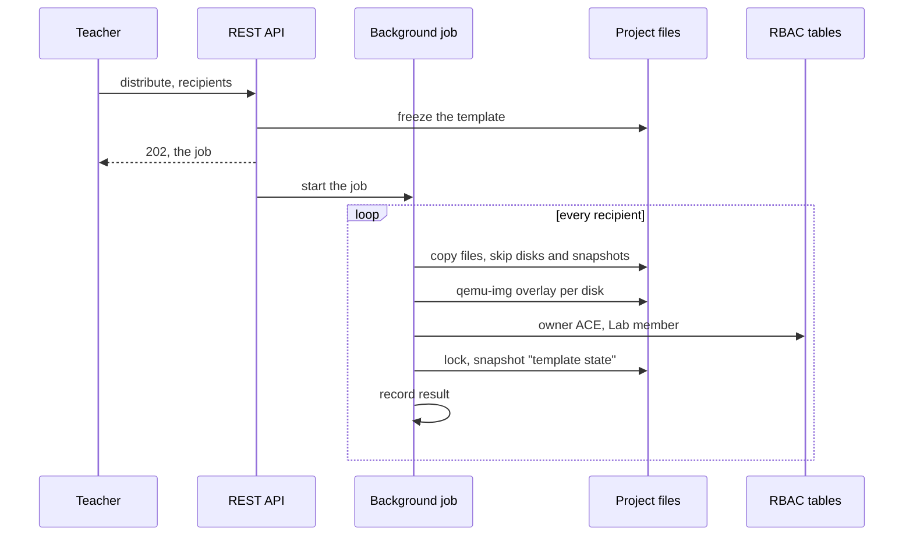
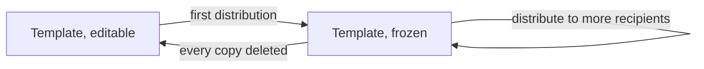

# Project Distribution

## Overview

`POST /projects/{project_id}/distribute` creates one copy of a project per recipient: a single user (`target_user`), every listed user (`target_users`) or every member of a user group (`target_group`). The copies are made by a background job — the request returns `202 Accepted` immediately with the job, and the client follows the progress by polling `GET /projects/{project_id}/distributions/{distribution_id}`. This is how a lab built by a teacher reaches every student: each recipient gets a personal copy they can use but not edit, because the owner ACE written on the copy carries a reduced role — the built-in "Lab member" role by default — instead of the full role the recipient keeps on their own projects.

The first distribution turns the source project into a template. The template is frozen for modification until every copy is deleted, and each copy's QEMU disks become thin qcow2 overlays backed by the template's disks instead of full copies: distributing a lab whose overlays weigh hundreds of megabytes to a whole class costs seconds of metadata work per recipient, not one full copy per recipient. The copies stay normal projects to their recipients — they start, run and restore independently — and only their disks depend on the template, which is exactly why the template cannot change while they exist.

A plain duplication stays a separate operation (`POST /projects/{project_id}/duplicate`): the copy belongs to the caller and is a full, independent copy. A group distribution is a fan-out, not a share: each member works on their own copy in isolation, and a restore resets only their copy. Sharing one project between several users is a different need, covered by [project sharing](project-sharing.md) and resource pools.

The copy also ships with a "template state" snapshot, so a recipient can reset the lab to its initial state on their own (`Snapshot.Restore`), and by default its nodes and drawings arrive locked: the client hides the move and delete actions from the start, so a recipient never begins a drag that can only end in a denial.

## Terms

| Term | Meaning |
|---|---|
| Distribution | One copy per recipient via the distribute endpoint: each copy belongs to its recipient |
| Distribution job | The background task making the copies; it records one result per recipient and is polled by the client |
| Group distribution | A fan-out: one copy per group member, each owned by that member |
| Template | The distributed source project, frozen for modification while copies exist |
| Thin copy | A distributed copy whose QEMU disks are qcow2 overlays backed by the template's disks |
| Copy marker | `distribution_master_id` in the copy's `.gns3` file: the template it was created from |
| Owner ACE | The user-level ACE on `/projects/<project_id>` created with every new project |
| Lab member | Built-in role carried by distributed copies by default: use the lab, do not touch the topology |
| Template state | Snapshot taken right after a distributed copy is created; the reset anchor for the recipient |

## Architecture

Every QEMU node already keeps only its own overlay in the project directory: the base image lives once in the shared images directory and the overlay references it as its backing file. Distribution adds one more layer to that chain — the template project's overlay becomes the backing file of each copy's overlay. A copy starts at the template state and stores only what its recipient writes; the read path falls back to the template disk for every block the copy never touched.

Only disk images become overlays. The rest of the QEMU node directory (config files, logs), the Docker persistent volumes, and the IOL/Dynamips configuration files are small and copied verbatim: a recipient's Docker node or router starts with exactly the configuration the teacher prepared, and their changes stay in their own copy.

The overlay stores an absolute backing path, so the chain is only valid on the controller host. A project with nodes on a remote compute falls back to the previous full export/import copy for that distribution. The project is still frozen after a fallback distribution: the copies are independent full copies, but the lifecycle stays the same for every distribution — one rule, no per-recipient exception to remember.

## Business Process

### Distribution and freeze

### Template lifecycle

Distributing again while frozen is allowed and safe: the template did not change, so the new copies are identical to the earlier ones — this is how a student who joins later gets their copy. The template is unfrozen only once every copy made from it is gone, through `POST /projects/{project_id}/unfreeze` (owner or superadmin). Copies go away in two ways: a recipient deletes their own copy, or the teacher calls `DELETE /projects/{project_id}/distributions/{distribution_id}/copies` to delete every copy of one distribution that still exists.

After the distribution, the recipient lists the copy like any of their projects (`Project.Audit`), opens it (`Project.Allocate`), works on the nodes (`Node.Console`, `Node.PowerMgmt`), captures on links (`Link.Capture`), manages their own markers (`Project.Marker`, `Link.Marker`) and resets the lab by restoring the "template state" snapshot (`Snapshot.Restore`). Topology edits and power operations are denied on the frozen template, and the reduced role denies the same edits on the copy; on top of that, nodes arrive locked, so a recipient can neither edit nor duplicate a node.

## API Endpoints

| Method | Path | Description | Privilege |
|---|---|---|---|
| POST | `/v3/projects/{project_id}/distribute` | Start a distribution job: one copy per recipient, in the background. Returns `202` with the job | `Project.Audit`, plus `Project.Allocate` somewhere the copy can live |
| GET | `/v3/projects/{project_id}/distributions` | List the recent distribution jobs of the project (the caller's own; every one for a superadmin) | `Project.Audit` |
| GET | `/v3/projects/{project_id}/distributions/{distribution_id}` | Poll one job: status, progress and the per-recipient results so far | `Project.Audit` |
| DELETE | `/v3/projects/{project_id}/distributions/{distribution_id}` | Cancel a running job: the copy in flight completes, the remaining recipients are skipped. Returns the job, `status` `cancelling`. On a finished job it removes the record, refused with `409` while a copy still exists | `Project.Audit`, and only the user who started the job (or a superadmin) |
| DELETE | `/v3/projects/{project_id}/distributions/{distribution_id}/copies` | Delete every copy of a finished distribution that still exists. Copies already deleted are skipped, the record stays | `Project.Audit`, and only the user who started the job (or a superadmin) |
| POST | `/v3/projects/{project_id}/unfreeze` | Unfreeze the template: allowed once no copy exists | `Project.Modify`, owner or superadmin |
| POST | `/v3/projects/{project_id}/duplicate` | Duplicate: the copy belongs to the caller. A distributed copy answers `409` | `Project.Duplicate`, plus `Project.Allocate` somewhere the copy can live |
| GET | `/v3/projects/{project_id}/export` | Export as a portable archive. A distributed copy answers `409` | `Project.Export` |

Request fields of `ProjectDistribute`:

| Field | Type | Description |
|---|---|---|
| `name` | string | Base name of the copies (required) |
| `reset_mac_addresses` | bool, optional | Reset MAC addresses on every copy |
| `target_user` | string, optional | Username receiving the copy, named `name`. Missing user: 404 |
| `target_users` | list of strings, optional | Every listed user receives their own copy, named `name-username`. Unknown name: 404 before the job starts; an empty list: 422 |
| `target_group` | string, optional | Every member of the group receives their own copy, named `name-username`. Missing group: 404, empty group: 409 |
| `owner_role` | string, optional | Role of the owner ACE on the copies. Default: `Lab member`. Missing role: 404 |
| `lock_topology` | bool, optional | Lock every node and drawing in each copy (`true` by default). Advisory: it tells the client to hide move and delete actions, while the owner role remains the enforcement. Pass `false` when distributing a role that may edit the topology |

Exactly one of `target_user`, `target_users` or `target_group` must be set (combining them, or none: 422). Recipients and role are resolved before the job starts, so a bad request distributes nothing.

The `202` response (and every poll) is the job: `{distribution_id, project_id, name, created_by, status, total, completed, results, error}`. `status` is `running`, `cancelling`, `cancelled`, `completed` or `failed`; `completed` counts the recipients processed so far, successful or not. `results` grows as the job goes: one `{username, project, error}` per recipient, where `project` is the recipient's copy on success and `error` carries the message when their copy could not be created (a failing recipient never stops the job; the others are unaffected). `error` on the job itself is set only when the job as a whole failed.

Cancelling is cooperative and never cuts a copy in half: the `DELETE` request switches the job to `cancelling` right away, but the copy in flight completes first — the job stops at the next recipient boundary and reports `cancelled`. Copies already made are real projects and are kept; only the recipients not started yet are skipped. Cancelling takes effect after the current copy finishes, so with heavy QEMU labs the `cancelling` state can last minutes. A finished or already cancelled job answers `409`, and a repeated cancel request while `cancelling` is accepted as a no-op.

The cleanup endpoint deletes the copies through the regular project deletion (close, remove the directory, drop their ACEs) and returns the distribution with its `results` and refreshed `project_exists` flags. It refuses a running job with `409`: cancel first, then clean up.

## Notes

The "Lab member" role carries exactly these privileges: `Project.Allocate`, `Project.Audit`, `Project.Marker`, `Snapshot.Audit`, `Snapshot.Restore`, `Node.Audit`, `Node.Console`, `Node.PowerMgmt`, `Link.Audit`, `Link.Capture`, `Link.Marker`, `Drawing.Audit`. It deliberately carries neither `Project.Duplicate` nor `Project.Export`: duplicating or exporting a copy would produce a project or archive whose disks still point at the template. The built-in Administrator and User roles carry both privileges. A superadmin bypasses the privilege checks, but the marker-based refusals still apply, and a distributed copy also refuses a second distribution (`409`) for the same reason.

While a template is frozen, the controller refuses project updates, node add/update/delete and power operations, link add/update/delete, drawing add/update/delete, lock or unlock, snapshot restore, and deleting the template itself: the endpoint answers `409` with the usernames of the recipients whose copy still exists. Opening the template, reading it and taking a snapshot stay available. Exporting the template is allowed too: the archive drops the freeze and copy markers, so it imports as a normal project elsewhere. Importing over a template or over a distributed copy is refused (`409`).

The copy marker `distribution_master_id` is written into the copy's `.gns3` file and exposed on the project API. It is server-local lifecycle state, not a property of the lab: export strips it (and `frozen`), and a plain duplicate of a frozen template stays a normal project (a copy is never frozen, and no other duplication path copies the marker). The template looks at the copies themselves to decide whether it can be unfrozen: every loaded project whose marker points at the template and whose directory still exists counts as a live copy. The history records are not the authority — a record can be deleted, and a crash can drop one before it records a copy — so deleting a record cannot fake an empty template. When no live copy is left, the owner or a superadmin unfreezes the template; the history records stay, so who received a copy and when remains readable.

Thin copies do not inherit the snapshots of the template. They start from the template's disk state, lock their items and take their own "template state" snapshot, which is small because the thin disks hold only the template state. The export/import fallback used with remote computes keeps the previous behavior, inherited snapshots included.

Overlay creation needs `qemu-img` on the controller host; the virtual size of the template disk is preserved (a disk grown with `qemu-img resize` does not shrink back). A recipient whose overlay creation fails is recorded as an error in the results and the job carries on with the next recipient.

A distributed copy is personal: it does not inherit the resource pools of the source project, and the distributing user has no access to it (an explicit share or a superadmin is needed to watch a recipient's work).

A group distribution reaches the members of the group at the time of the call. Members added later have no copy: the teacher distributes again for them, which is allowed while the template is frozen. Copies of a multi-recipient distribution are named after the lab and the recipient (`lab1-alice`). The template stays frozen as long as any copy from any of its distributions exists.

`owner_role` accepts any existing role, custom ones included. An ACE on `/projects/<project_id>` can only reach project-scoped paths, so even a generous role cannot unlock user, compute or server administration through a copy.

Each copy arrives locked (`lock_topology`, `true` by default): every node and drawing carries the advisory `locked` flag, so the client hides move and delete actions from the start instead of letting a drag end in a denial and a ghost move. The controller also refuses to duplicate a locked node, so a locked node cannot be cloned behind the advisory flag. The lock is taken before the "template state" snapshot, so restoring the snapshot brings the items back locked. Locks the teacher put on the source ride along with the copy, even with `lock_topology` set to `false`. A role that carries `Node.Modify` and `Drawing.Modify` can also unlock the items again: the flag advises, the role decides.

A thin distribution no longer scales with the disk payload: each recipient costs a copy of the small config files, one `qemu-img create` per disk (metadata only) and the "template state" snapshot zip, whose content is the copy's thin disk and files. The disk payload itself is written once, in the template. The price is the dependency: the template cannot be deleted, modified or exported over while copies exist, and a copy cannot be exported, duplicated or re-distributed. Instantiation from templates without any file copy remains future work.

Distribution jobs live in an in-process registry, like the rest of the controller state, and every state change is written through to a `distribution_records` database row: who distributed the project, to which recipients, and how far the job got. The distribution history (`GET /projects/<project_id>/distributions`) reads the persisted records and survives server restarts; the per-job endpoint serves a live job from the registry (fresher than the last write-through) and falls back to the record once the job is gone. A record still marked running or cancelling whose job is not in the registry was cut short by a restart: listing the history closes it out as failed (running) or cancelled (cancelling), keeping the per-recipient results recorded up to that point. A finished job stays in the registry for one hour, then it is pruned from memory — the record stays.

Each successful result carries `project_exists`, computed at read time against the controller's view of the projects directory: a recipient may have deleted their copy, and the history flags the copy as gone so the cleanup can be run knowingly. Deleting a project removes its records (they only hang off the project). Removing one record of a finished distribution is refused with `409` while any copy of that record still exists: the record is how those copies are found for the bulk cleanup, so it cannot vanish before them. The copies endpoint deletes the copies and keeps the record. A record of a deleted template is unreachable from the per-project endpoints but still visible, and deletable, from the cross-project listing.

A distribution management page does not need to walk the project list: `GET /distributions` returns the history across every project (the caller's own, every one for a superadmin), each entry carrying the name of the distributed project (`project_name`, None when that project no longer exists on the server). A default ACE grants the "User" role on `/distributions`. `DELETE /distributions/<distribution_id>` removes one record whatever happened to its project — a project directory removed directly leaves its records unreachable from the per-project endpoints — and refuses a running distribution with 409 (cancel it on its project).
