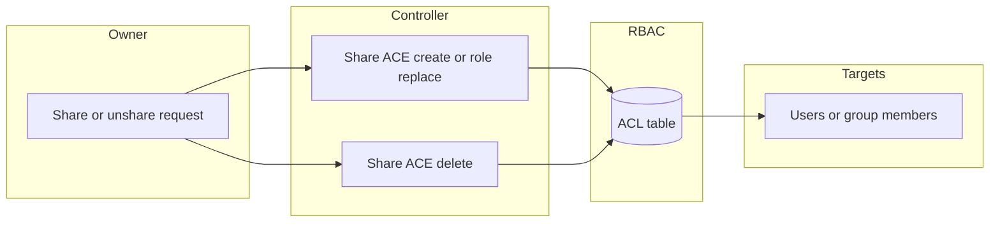
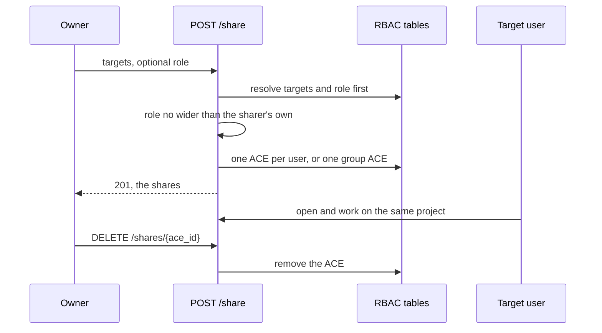

# Project Sharing

## Overview

`POST /projects/{project_id}/share` gives other users access to one existing project: no copy is created, every target works on the very same project. A share targets a single user, a list of users or a whole user group, and carries a role — the built-in "Lab member" role by default, so the targets can use the lab but not touch its topology, just like a distributed copy. This is the "many eyes on one project" need: looking at a problem together, pair work, or a teacher watching a student's lab.

Sharing is the counterpart of distribution ([project distribution](project-distribution.md)), which creates a personal, frozen copy per recipient. Undoing a share is `DELETE /projects/{project_id}/shares/{ace_id}`.

## Terms

| Term | Meaning |
|---|---|
| Share | An ACE on the project path giving one user or one user group a role on that project |
| Share ACE | The ACE written by the share endpoint: a user ACE per user target, or a single group ACE for a group target |
| Lab member | Built-in role carried by a share by default: use the lab, do not touch the topology |
| Owner ACE | The user-level ACE on `/projects/<project_id>` created with every new project; it is not a share |

## Architecture

A share is an ACE, nothing more: the freeze (or the openness) of a shared project comes from the role the ACE carries, evaluated by the ordinary RBAC rules. A user-level share ACE decides alone on its path, so a broad group grant cannot widen what a share with a reduced role allows.

## Business Process

Everything is resolved before the first ACE is written: an unknown user or group, an unknown role, or an empty group means nothing is shared. Sharing again with the same target replaces the role of its existing ACE instead of stacking a second one.

## API Endpoints

| Method | Path | Description | Privilege |
|---|---|---|---|
| POST | `/v3/projects/{project_id}/share` | Share the project with user(s) or a group. Returns `201` with the created shares | `Project.Audit`, owner or superadmin |
| GET | `/v3/projects/{project_id}/shares` | List the shares of the project (the owner ACE excluded) | `Project.Audit`, owner or superadmin |
| DELETE | `/v3/projects/{project_id}/shares/{ace_id}` | Remove one share | `Project.Audit`, owner or superadmin |

Request fields of `ProjectShare`:

| Field | Type | Description |
|---|---|---|
| `role` | string, optional | Role carried by the share. Default: `Lab member`. Missing role: 404 |
| `target_user` | string, optional | Username the project is shared with |
| `target_users` | list of strings, optional | Every listed user, one share each (duplicates collapsed). Unknown name: 404; empty list: 422 |
| `target_group` | string, optional | The whole group, one group ACE. Missing group: 404, empty group: 409 |

Exactly one of `target_user`, `target_users` or `target_group` must be set (combining them, or none: 422).

Every share endpoint returns `{ace_id, username, group_name, role, created_at, updated_at}` records — `username` is set for a user share, `group_name` for a group share. `ace_id` is what a later `DELETE` takes.

## Notes

Only the project owner (its `created_by`) or a superadmin can share, list or remove shares. Having access through a share — even with `Project.Audit` — does not make a target a share manager.

A share cannot grant a role with privileges the sharer does not hold on the project. In particular the owner of a distributed (frozen) copy cannot unfreeze it by sharing it to anyone, themselves included: the share would have to carry a wider role than the frozen one they hold. Superadmins are not bound by this rule.

A share target cannot delete the project, and cannot import another archive on top of it: both destroy the project, and both are reserved to its owner and to superadmins. This matters because the "Lab member" role carries `Project.Allocate` — required just to open the project — and allocation alone must not grant destruction of a project the caller does not own.

There is no snapshot and no reset anchor here: a restore, a topology edit or a node power cycle hits the one shared project and therefore every user of it. Give out the "Lab member" role when the topology must stay put, or distribute copies instead when each recipient needs an isolated lab.

A group share is one ACE on the group, so members joining the group later get access too — unlike a group distribution, which copies to the members of the group at the time of the call.

Deleting a project removes its share ACEs with it (the ACL cleanup by path). Resource pools remain the administrator-side bulk mechanism; the share endpoint is the owner-side one.
