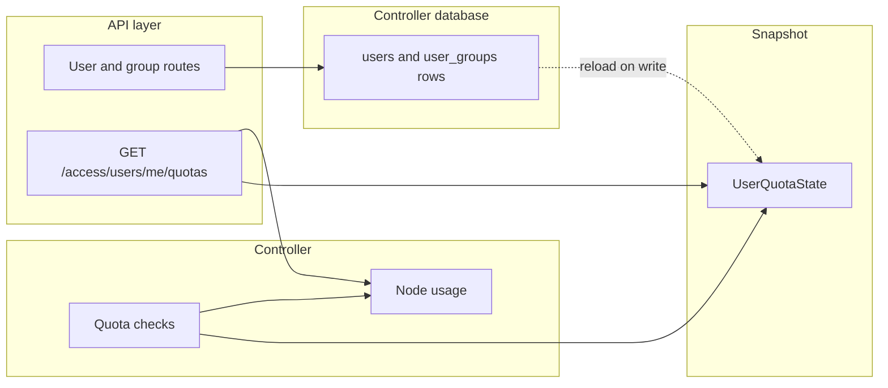
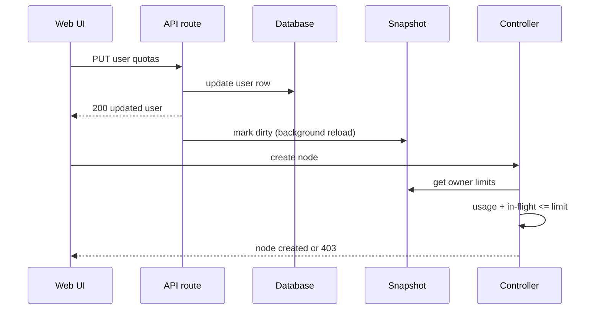

# User Node Quotas

## Overview

A per-user node quota limits how many nodes a user can own and how many of them can run at the same time, across all their projects and regardless of the node type. Two knobs exist: the total number of nodes (`max_nodes`) and the number of simultaneously running nodes (`max_running_nodes`). Quotas are optional — a user without limits keeps the previous unlimited behavior, and superadmins are never limited.

The quota of a project owner also covers what other users do inside a project shared with them: nodes created or started by a guest count against the owner, not the guest.

## Terms

| Term | Meaning |
|---|---|
| Quota-relevant node | A node of a type that consumes resources: QEMU, Docker, Dynamips, IOU, VPCS, VirtualBox, VMware. Always-running types (Ethernet switch, hub, cloud, NAT) are free |
| Owner | The `created_by` user of a project; the quota accounting unit |
| User override | The `max_nodes` / `max_running_nodes` columns on the user row |
| Group default | The `default_max_nodes` / `default_max_running_nodes` columns on a user group |
| Reservation | An in-flight slot taken between the quota check and the moment the usage counters actually reflect the operation |

## Semantics

A NULL user override falls back to the group defaults; a numeric override replaces them. `-1` explicitly means unlimited, which is how one user can be freed from a group limit without touching the group. Among several groups the widest default wins: one unlimited group makes the member unlimited, otherwise the largest number applies. A user without any group is unlimited.

The usage accounting covers every project known to the controller, opened or closed: opened projects are counted from memory, closed projects from their `.gns3` file (cached by file mtime). Running nodes only exist in opened projects because closing a project stops its nodes.

Lowering a quota never fights the existing usage: existing nodes stay where they are and only new operations are refused.

## Architecture



The controller paths that enforce quotas (node creation, node start) have no database session, so they read a process-wide snapshot (`gns3server/db/user_quota_state.py`) resolved once at startup. Repository writes mark the snapshot dirty, which schedules a background reload — the new limits apply within milliseconds of an administrative change.

## Business Process



The check runs on three paths: `Project.add_node` (covers the API creation, node duplication and templates — but not the replay of existing nodes when a project opens), `Node.start` / `Node.reload` (covers single starts, start-all and reloads; starting an already started node is free), and `import_project` (covers imports, project duplication and distributions — each distribution recipient is checked against its own quota and a refusal is recorded as that recipient's error without stopping the job).

Because the node registration (or the compute accepting a start) happens after the check, each checked operation first reserves an in-flight slot that is released when the usage counters take over. Without it, a burst of concurrent requests (start-all, a classroom of clients) would each pass the check before any of them is accounted. The reservation is atomic on the event loop, so the limit holds under concurrency.

## API Endpoints

| Method | Path | Description | Privilege |
|---|---|---|---|
| PUT | `/v3/access/users/{user_id}` | Set `max_nodes` / `max_running_nodes` (-1 = unlimited, null = inherit the group) | User.Modify |
| GET | `/v3/access/users/{user_id}` | Read the stored user values | User.Audit |
| PUT | `/v3/access/groups/{user_group_id}` | Set `default_max_nodes` / `default_max_running_nodes` | Group.Modify |
| GET | `/v3/access/users/me/quotas` | Effective limits plus current usage for the logged-in user | authenticated |

Example `GET /v3/access/users/me/quotas`:

```json
{
  "max_nodes": 100,
  "max_running_nodes": 20,
  "current_nodes": 35,
  "current_running_nodes": 12
}
```

A refused operation returns 403 with the limit in the message, for example `Cannot create node in project 'lab1': user 'alice' reached the maximum number of nodes (100)`.

## Notes

Snapshots restore (importing an archive over the project it came from) are not checked: they replace the nodes they already contain. Imports without a future owner (system paths that keep the archive's original `created_by`) are not checked either — an ownerless project can only be used by superadmins, who are never limited.
