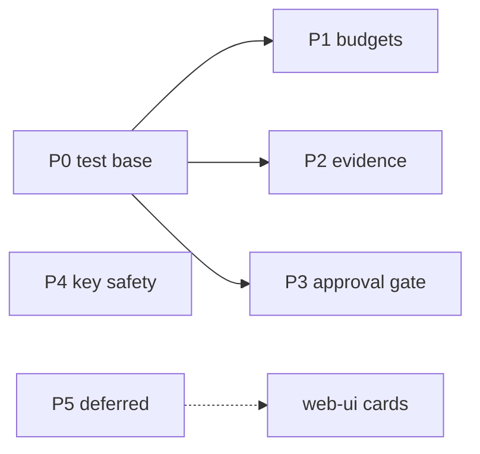
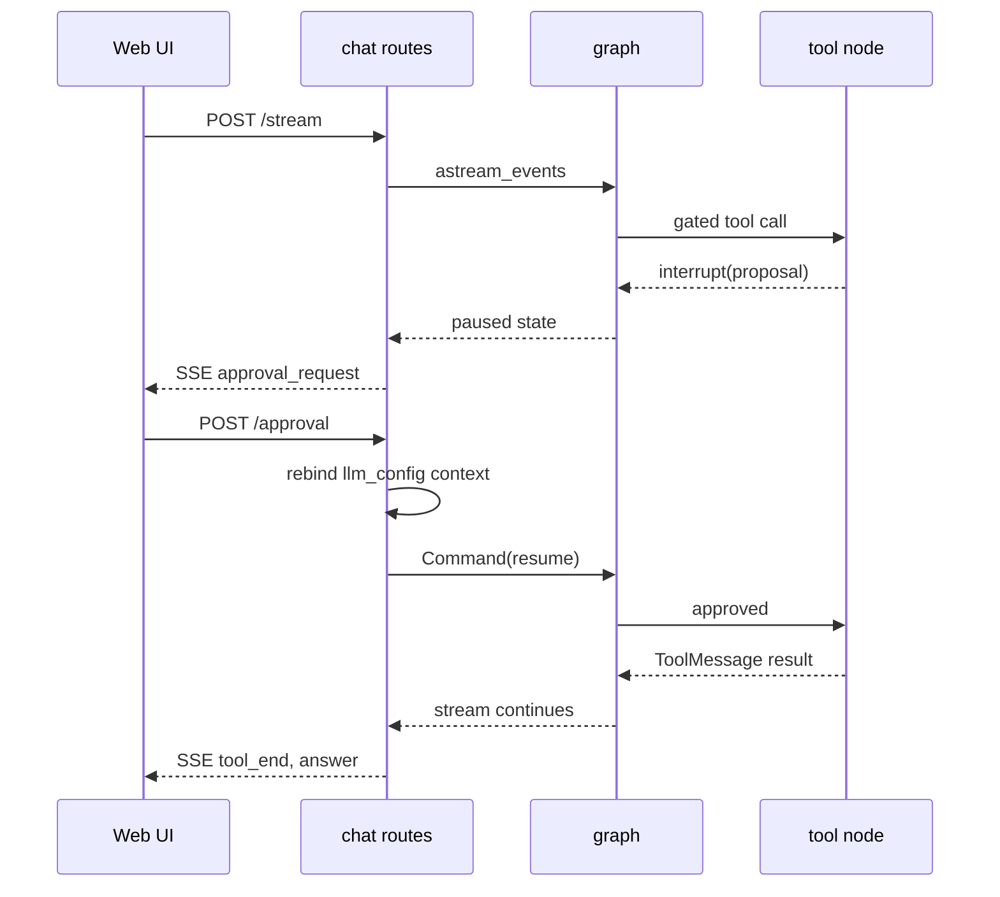

<!--
SPDX-License-Identifier: CC-BY-SA-4.0
See LICENSE file for licensing information.
-->

# Copilot Hardening Roadmap

## Overview

This roadmap adds guardrails to GNS3-Copilot in six phases: an offline test harness, hard budgets per turn, external evidence storage for tool output, an approval gate for configuration commands, safer key handling, and a few deferred items. Each phase is one pull request that can merge and roll back on its own. The plan follows a review of the iCheck agent platform; where GNS3 differs, this document says so.

## Background

The copilot works today, but it has no guardrails. Tool output of any size enters the message history, the only loop protection is a recursion limit, configuration tools run the moment the model asks, and the API key sits in plaintext in the controller database. For a tool that community users run with their own API keys, this is the gap between "runs" and "safe to hand out".

The analysis compared the copilot against iCheck (a production agent platform with externalized evidence, enforced budgets, an approval workflow, and hardened provider transport). iCheck's governance core (dual approval, idempotency hashes, multi-tenant audit) is too heavy for a lab tool; the guardrail ideas transfer well.

## Terms

| Term | Meaning |
|---|---|
| turn | One user message plus the full tool loop it triggers |
| evidence | The full tool output, stored in the project database |
| bounded view | The short replacement text that stays in the ToolMessage |
| approval gate | A pause point where the user approves configuration commands before they run |
| budget | A hard per-turn limit on LLM calls or tokens |

## Current State

All items below were verified against the code on branch `3.1`.

| Area | Behavior today | Where |
|---|---|---|
| Tool output size | No truncation; the full JSON dump enters the ToolMessage | `tool_node` in `gns3server/agent/gns3_copilot/agent/gns3_copilot.py` |
| Context trimming | Whole-message trim only; one huge message still breaks the window | `gns3server/agent/gns3_copilot/agent/context_manager.py` |
| Budgets | Token usage is counted in session stats but never enforced | `stream_chat` in `gns3server/agent/gns3_copilot/agent_service.py` |
| Configuration commands | The model executes them directly in lab modes | `tools_v2/config_tools_nornir.py`, `tools_v2/gns3_packet_filter.py` |
| API key | Plaintext inside the config JSON column of the controller database | `gns3server/db/models/llm_model_configs.py` |
| Abort | In-memory module-level dict; lost on restart | `_abort_flags` in `gns3_copilot.py` |
| SSE stream | Forwarded straight from the graph; no replay after a disconnect | `gns3server/api/routes/controller/chat.py` |
| Graph tests | None; the graph cannot run without a real model | `tests/` |

Two extra findings from the same review: the message list grows only (`operator.add`), so huge tool outputs also stay forever in `copilot_checkpoints.db`; and `llm_call` refetches the whole topology on every ReAct hop.

## Phase Map

Phase 4 has no dependency and can run in parallel. Phase 5 waits for web UI work. Three small fixes (see Quick Fixes) can land in any order.

## Phase 0 — Test Foundation

**Status**: delivered on branch `copilot-hardening-phase0`.

**Goal**: run and test the graph without a real model. Every later phase needs this.

**Changes**:

- Open a seam at the model construction inside `llm_call` (today it calls `create_base_model_with_tools` directly). Tests replace the factory per test case. The replacement must be installed at call time, not at import time, to avoid the frozen-monkeypatch ordering problem seen elsewhere in the test suite.
- Add a `ScriptedChatModel` fake: it replays a queue of AIMessage objects (tool calls first, final answer last) and can be told to raise, to simulate failed calls.
- Add fake tools with canned large outputs for Phase 2 tests.
- Compile the graph with `MemorySaver`; no SQLite in these tests.

**First tests**: ReAct round trip; abort mid-tool (flag set, `abort_handler_node` fills aborted ToolMessages, history stays consistent); title generation on the first turn only; the `remaining_steps` guard; the tool error path.

`tool_node` stays synchronous (decision D2).

## Phase 1 — Hard Budgets

**Status**: delivered on branch `copilot-hardening-phase1`.

**Goal**: a runaway turn ends with a clear message, not a naked error.

**Changes**:

- Two optional keys in the `llm_model_configs` config JSON: `max_llm_calls_per_turn` and `max_total_tokens_per_turn`. The config column is JSON, so no schema migration is needed.
- Per-turn accumulators in the graph state (`llm_calls` already existed as a per-turn counter reset by the stream inputs; `turn_tokens` follows the same mechanism).
- Check at the `llm_call` entry, before the topology fetch and the model call: over the limit, return an AIMessage that explains the limit and route to END. The frontend sees a normal assistant message, not an error event.
- Token accounting prefers `response.usage_metadata` and falls back to a tiktoken estimate over request and response text, so providers that report no usage still feed the budget.
- `stream_chat` sizes the recursion limit from the configured call budget (two graph steps per call plus headroom), so the budget — not the silent recursion guard — ends runaway turns.
- Failed model calls keep the existing behaviour: the error propagates and the turn ends with an error event. In a graph with no retry and no fallback there is no free-failure loop to abuse — a failed call always ends the turn, and the budget resets on the next message. Failed-call accounting becomes worth adding when a fallback model chain lands (iCheck charges failed calls because its loop continues past them).

**Defaults** (decision D6): 10 model calls per turn, 40 for `troubleshooting_injection`. The call budget defaults sit below what the recursion limits allow, so today's effective ceilings are preserved while gaining the explained ending and configurability.

**Tests**: a scripted model that always requests tools hits a configured call cap and the default cap (before the recursion guard); reported usage accumulates; a configured token cap ends the turn; missing usage falls back to the estimate.

## Phase 2 — Evidence Store

**Goal**: context stays small, evidence stays queryable, checkpoints stop growing with tool output.

**Changes**:

- New `tool_evidence` table in `copilot_checkpoints.db`, created the same way as `chat_sessions` (CREATE IF NOT EXISTS plus a column check), with a small repository class.
- Write path in `tool_node`: store the full observation, then put a bounded view in the ToolMessage — head 2 KB plus tail 2 KB by default; for multi-device dict results, one status line per device plus the first error line.
- The bounded view carries an evidence id and a hint to call the retrieval tool.
- New `GetEvidenceTool(evidence_id, offset, limit)` registered in all three modes.
- Cap one evidence row at 2 MB; larger input is stored truncated with a flag.
- The write path uses a dedicated synchronous `sqlite3` connection with `busy_timeout` set (tool_node is sync; the checkpointer connection is async; WAL mode is already on, so multiple connections are safe).
- No migration for old sessions; their checkpoints stay as they are.

**Tests**: a fake tool returns 1 MB; the state message stays small; the evidence row holds the full text; `GetEvidenceTool` reads it back.

## Phase 3 — Approval Gate

**Goal**: the model proposes, the user approves, then commands run. This is also the teaching step between `teaching_assistant` and `lab_automation`.

**Scope first**: `ExecuteMultipleDeviceConfigCommands` and `GNS3PacketFilterTool`.

**Mechanics**: `tool_node` calls `interrupt()` before a gated tool runs, with the command list and target devices in the payload. The AsyncSqliteSaver checkpointer already persists interrupt state. Approve resumes the graph with `Command(resume=...)`; reject returns a rejected ToolMessage to the model.

**Critical detail**: the resume is a new request. `llm_config` and the JWT token live in request-scoped context variables, and `llm_call` reads them on every hop; the approval endpoint must rebind them or the resumed run fails at once.

### API Endpoints

| Method | Path | Description |
|---|---|---|
| GET | `/copilot/projects/{project_id}/chat/sessions/{session_id}/approval` | Read the pending proposal after a reconnect |
| POST | `/copilot/projects/{project_id}/chat/sessions/{session_id}/approval` | Approve or reject; approve resumes the stream via SSE |

**Open decision** (D4): the `teaching_assistant` tool list contains create node, link, and start tools although its docstring says read-only. Default plan: keep them and gate them too, because "AI proposes the topology, student approves" is exactly the teaching bridge. The alternative is to move them to `lab_automation`.

**Tests**: a scripted model proposes a config; the graph interrupts; approve runs the command; reject returns the rejection message. Both paths run offline.

## Phase 4 — Key and Outbound Hardening

**Goal**: a leaked database file does not leak the API key, and the key never travels to an unintended origin.

This phase diverges from iCheck on purpose (decision D3). iCheck allows only fixed provider origins. GNS3 users point the copilot at home lab model servers (vLLM, Ollama, LM Studio); a hard allowlist would break them. So: presets plus validated custom origins.

**Changes**:

- Origin validation on create and update of LLM model configs: the base URL must have an http(s) scheme, a host, and no userinfo. A known-provider preset list ships in code. When a key is set and the origin is not a preset, the response carries a warning field.
- Encryption at rest: store `api_key` as an `enc:v1:` envelope (AES-GCM). The encryption key lives in a 0600 file under the config directory, created on first use. Existing plaintext values upgrade lazily on the next save.
- 422 redaction: a RequestValidationError handler for the llm-model-configs and auth paths that strips the echoed input, mirroring the iCheck approach.
- Keep what already works: every CRUD response masks `api_key` to None (`_filter_api_key_from_config`), and httpx does not follow redirects by default. Verify the redirect behavior per provider and pin it with a test instead of building new machinery.

**Tests**: route-level tests per the API test conventions; encryption round trip; lazy upgrade from plaintext; the warning path for non-preset origins.

## Phase 5 — Deferred Items

These wait for web UI work and are listed here so they are not forgotten:

- **Structured final answers**: a schema per mode (diagnosis report, lab checklist, injection plan). Note the tension with token streaming; the candidate shape is streaming markdown plus a side-channel structured artifact.
- **SSE resume**: per-session event buffer with sequence ids and Last-Event-ID.
- **Persisted cancel**: a `cancel_requested` column on `chat_sessions`, with the in-memory flag kept as the fast path.

## Quick Fixes

Three small, independent fixes that can land in any order:

1. **Shield session stats**: the stats update and title sync run after the stream loop inside the generator; a client disconnect cancels them. Move them into a shielded block in `stream_chat`.
2. **Cache the topology per turn**: `llm_call` refetches the whole topology on every ReAct hop. Cache it in state and invalidate after topology-mutating tools (the model can create nodes mid-turn, so a once-per-turn fetch is wrong).
3. **Honest teaching mode docstring**: align the docstring with the real tool list until D4 is decided.

## Decision Records

- **D1 — Tests first.** The original analysis ranked the test harness last. We do it first: phases 1 to 3 all change graph behavior, and without the harness each one can only be checked against a live model.
- **D2 — `tool_node` stays synchronous.** Async was evaluated and dropped. Sync nodes already run in a thread pool under `astream_events`, so blocking tools do not touch the event loop. An async node that calls sync `invoke` directly would freeze every stream on the server; `ainvoke` would move the same tools to the same threads and buy nothing today. Multiple tool calls in one turn stay sequential either way: they can depend on each other (create node, then link).
- **D3 — Custom base URLs stay allowed.** Home lab model servers are a real GNS3 use case. Validate the URL and warn when a key leaves the preset origins; do not block.
- **D4 — Teaching mode gate (open).** Default: gate the mutating tools, do not remove them. Final call during Phase 3.
- **D5 — Budgets are per turn, not per session.** Sessions live for a whole lesson; a session-level token cap would cut off long classes.
- **D6 — Budget defaults sized below the recursion limits** (10 calls per turn, 40 in injection mode), and the recursion limit grows with a configured budget. The original plan said 30/60, but 30 can never fire under the default `recursion_limit=25` (about 11 model calls fit): the recursion guard would stay the real limit and the budget would be decoration. The defaults preserve today's effective ceilings while making the budget the authoritative, explained limit.

## Out of Scope

- Multi-tenancy, copilot-internal RBAC, quota accounting.
- PostgresSaver; per-project SQLite is the right fit for portability and isolation.
- The decision-envelope loop pattern from iCheck; the message pattern fits GNS3 streaming and dialogue.
- Full governance: dual approval, idempotency hashes, rollback authorization.

## Verification Discipline

- Each phase merges as its own pull request with offline tests written first (after Phase 0).
- Manual smoke by the maintainer before merge; the smoke points are listed per phase above.
- End-to-end tests that need a real model or real devices go to `tests/e2e` with markers; the full e2e suite runs only on explicit request.
